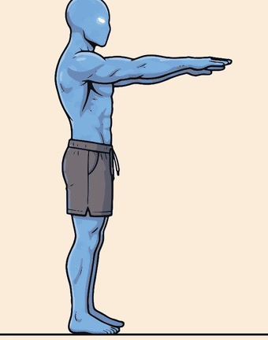

# video_skills

Agent skills for making short animated videos cheaply, without video-generation models.

| Skill | What it does |
|---|---|
| [`sprite-video`](skills/sprite-video/SKILL.md) | One or two Nano Banana (Gemini image) sprite sheets → frames traced to SVG → camera moves → 4K MP4. A 5 s cartoon clip costs about **$0.20** in image calls. |
| [`yellow-dude-4k-animator`](skills/yellow-dude-4k-animator/SKILL.md) | Yellow Dude (Gravgear) style 4K calisthenics explainers: 3 key poses → 24-frame contour-mesh warp loop with SDF blending, bar grip, effort face, 6-point critique checklist. Remotion and HyperFrames templates included. Run `python scripts/yellow_dude_4k_pipeline.py [pose_sheet.png]`; without an argument it uses the example `assets/pullup_poses.jpg`. |
| [`viral-motion`](skills/viral-motion/SKILL.md) | Motion-graphics videos at three levels (showreel, lyric video with an original song, story film with score and sound design) through HyperFrames. Music, voice and sound effects are made locally: **$0**, no Gemini. See [Viral Motion](#viral-motion). |

<p>




</p>

## How it works (short)

1. Generate a **base pose** of the character (1 image, 2K).
2. Build a **template**: the base pasted into every cell of a grid, plus red guides (lines, circles,
   shoulder-elbow-wrist dots) where a limb must go. For whole-body moves the body is roughly rigged in
   code (rotated about the toes for a push-up; for a squat, cut into foot/shin/thigh/torso/arm pieces
   placed by forward kinematics).
3. Nano Banana fills the template in **one call**: every cell becomes one animation frame, same size
   and position, limb drawn along the guides.
4. Code slices the sheet, traces each frame to **SVG** (potrace ink + vtracer colour fills), aligns
   frames, and films them with a slow camera at **3840×2160**.
5. Optional: one more cheap edit (1K) paints the working muscles red on the sheet; the player fades
   them in as a pulsing highlight (e.g. chest and front delts in a fly).
6. The agent reviews every frame like a film critic (shake, floating torso, jumps, missing
   in-betweens) and fixes it over three rounds.

Why 2K is enough: the SVG keeps edges sharp at any size, so the 4K video comes from the vector, not
from a bigger image ([2K vs 4K comparison](assets/trace_4k_vs_2k.png)).

## Install

Clone once:

```bash
git clone https://github.com/zullum/video_skills.git
cd video_skills
```

Then install for the tool you use (`install.sh` installs every skill in `skills/`; copies by default, add `--link` to symlink so `git pull` updates it):

### Claude Code

Working inside this repo? Nothing to install: `.claude/skills/` links to every skill, so Claude
Code loads them automatically in any session opened on this repository.


```bash
bash install.sh claude                       # → ~/.claude/skills/sprite-video (all projects)
bash install.sh claude --project /path/to/project   # → /path/to/project/.claude/skills/
```
Manual: `mkdir -p ~/.claude/skills && cp -R skills/sprite-video ~/.claude/skills/`
Start a new Claude Code session. The skill loads when the task matches, or ask: "use the sprite-video skill".

### OpenAI Codex (CLI / IDE)

```bash
bash install.sh codex                        # → ~/.agents/skills/sprite-video
bash install.sh codex --project /path/to/repo      # → /path/to/repo/.agents/skills/
```
Manual: `mkdir -p ~/.agents/skills && cp -R skills/sprite-video ~/.agents/skills/`
Older Codex versions read `~/.codex/skills/` instead:
`mkdir -p ~/.codex/skills && cp -R skills/sprite-video ~/.codex/skills/`
Restart Codex if the skill does not show up; invoke it with `$sprite-video` or just describe the task.

### Google Antigravity

```bash
bash install.sh antigravity                  # → ~/.gemini/antigravity/skills/sprite-video (global)
bash install.sh antigravity --project /path/to/workspace   # → /path/to/workspace/.agent/skills/
```
Manual: `mkdir -p ~/.gemini/antigravity/skills && cp -R skills/sprite-video ~/.gemini/antigravity/skills/`
Some Antigravity versions scan `.agents/skills/` (plural) in the workspace; if the skill is not found,
copy it there as well.

### All three at once

```bash
bash install.sh all --deps     # installs the skill for every tool + Python packages + Chromium
```

## Requirements (sprite-video, yellow-dude-4k-animator)

- Python 3.10+ with `numpy scipy pillow vtracer potracer` (+ `opencv-python-headless` for yellow-dude-4k-animator) (`pip install -r requirements.txt`)
- Node 18+ with Playwright (`npm i -D playwright && npx playwright install chromium`) and `ffmpeg`
- A Gemini API key in `GEMINI_API_KEY` (image model `gemini-3.1-flash-image`). Keep it in your
  environment or secret manager; never commit it.

## Cost (sprite-video)

| | Price |
|---|---|
| Base pose (2K) | ~$0.10 |
| Sprite sheet (2K) | ~$0.10 |
| Optional in-between sheet (2K) | ~$0.10 |
| Tracing, rendering, the agent | $0 extra |
| **Typical 5 s clip** | **~$0.20–0.30** |
| 5 s of Veo 3.1 for comparison | ~$0.40 (Lite 1080p) to ~$3.00 (Standard 4K) |

Prices: Gemini API standard tier, October 2026. Check https://ai.google.dev/pricing.

## Viral Motion

A fork of the "Motion Studio" skill by its original author (the first commit under
`skills/viral-motion` is that original, untouched; its git history shows every change since). It adds a
Watercolor style, your own voice Recording (any language) or your own music, English Kokoro narration, a
separate Critic, two checkpoints and portrait 1080x1920 by default. Details: [its README](skills/viral-motion/README.md).

Setup (macOS, Apple Silicon recommended). Install it with `install.sh` like any skill, then run
`bash ~/.claude/skills/viral-motion/scripts/check.sh`: it installs nothing and prints the fix for each
missing piece:

- Node 22+, `ffmpeg`, the HyperFrames CLI + its Chrome, and the HyperFrames skills (`npx hyperframes skills`)
- ACE-Step 1.5 for music (~11 GB of models, keep ~10 GB more free while generating): put its checkout path
  in `SKILL/.acestep` and apply `scripts/music/acestep-mps-bf16.patch`; demucs in its venv
- whisper.cpp with the `large-v3-turbo` and `large-v3` models at `~/myprojects/whisper.cpp` (word timing)
- the skill's own Python 3.12 venv (`numpy soundfile kokoro-onnx`) and the Kokoro voice models
- `GEMINI_API_KEY` / `GOOGLE_API_KEY` blank in the sessions that make videos

Level 1 (showreel) needs only the first line. Prove the setup with `scripts/selftest.sh`.
`install.sh` replaces an installed copy, including its `.venv` and `.acestep`, so re-run `check.sh` after it.

## Repo layout

```
skills/sprite-video/
  SKILL.md               the workflow the agent follows
  scripts/gen.py         one Nano Banana call (reference images in, PNG out)
  scripts/template.py    grid template: base in every cell, rigging, erase, red guides
  scripts/slice.py       cut the sheet, align on the head, trace each frame (trace2.py)
  scripts/trace2.py      two-layer vectorizer: potrace ink + vtracer fills
  scripts/colorfix.py    match an extra sheet's colours to the main sheet
  scripts/merge.py       join frames from several sheets
  scripts/muscles.py     working-muscle overlay per frame from one marked copy of the sheet
  scripts/player.html    frame sequencer + camera (push-in, pan, punch), floor line
  scripts/shoot.cjs      film the player to MP4 / PNG, --scale 2 for 4K
  references/            prompt templates, film-critic checklist, costs
  examples/              push-up IK rig, squat multi-joint rig, two-arm fly guides, flex all-cells template, arm-raise guides
skills/yellow-dude-4k-animator/
  SKILL.md               7 golden rules + 6-point critique protocol
  scripts/yellow_dude_4k_pipeline.py   v15 pipeline: 3 poses → 24 frames → 30 s 4K MP4
  references/            Remotion + HyperFrames 3-layer templates
  assets/pullup_poses.jpg  example pose sheet (default input)
skills/viral-motion/
  SKILL.md               levels, director's brief, ban list, checkpoints, quality gates
  references/            level guides, music, sound design, narration, recording, critic, watercolor, lessons
  scripts/               check, hf (HyperFrames without Gemini), music, sfx, recording, qa
  assets/                Watercolor engine, the Critic's reference frames
  examples/ templates/   the three original prompts, song / score / cue templates, a self-test clip
install.sh               installer for Claude Code / Codex / Antigravity
```
