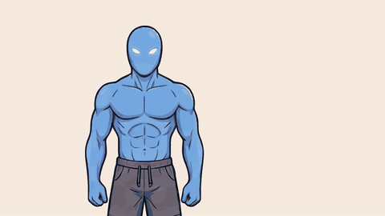
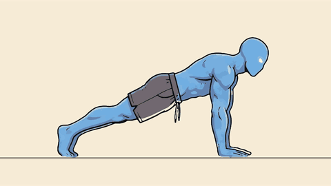

# video_skills

Agent skills for making short animated videos cheaply, without video-generation models.

| Skill | What it does |
|---|---|
| [`sprite-video`](skills/sprite-video/SKILL.md) | One or two Nano Banana (Gemini image) sprite sheets → frames traced to SVG → camera moves → 4K MP4. A 5 s cartoon clip costs about **$0.20** in image calls. |

<p>


</p>

## How it works (short)

1. Generate a **base pose** of the character (1 image, 2K).
2. Build a **template**: the base pasted into every cell of a grid, plus red guides (lines, circles,
   shoulder-elbow-wrist dots) where a limb must go. For whole-body moves the body is roughly rigged in
   code (e.g. rotated about the toes for a push-up).
3. Nano Banana fills the template in **one call**: every cell becomes one animation frame, same size
   and position, limb drawn along the guides.
4. Code slices the sheet, traces each frame to **SVG** (potrace ink + vtracer colour fills), aligns
   frames, and films them with a slow camera at **3840×2160**.
5. The agent reviews every frame like a film critic (shake, floating torso, jumps, missing
   in-betweens) and fixes it over three rounds.

Why 2K is enough: the SVG keeps edges sharp at any size, so the 4K video comes from the vector, not
from a bigger image ([2K vs 4K comparison](assets/trace_4k_vs_2k.png)).

## Install

Clone once:

```bash
git clone https://github.com/zullum/video_skills.git
cd video_skills
```

Then install for the tool you use (copies the skill; add `--link` to symlink so `git pull` updates it):

### Claude Code

Working inside this repo? Nothing to install: `.claude/skills/sprite-video` links to the skill, so Claude
Code loads it automatically in any session opened on this repository.


```bash
bash install.sh claude                       # → ~/.claude/skills/sprite-video (all projects)
bash install.sh claude --project /path/to/project   # → /path/to/project/.claude/skills/
```
Manual: `mkdir -p ~/.claude/skills && cp -R skills/sprite-video ~/.claude/skills/`
Start a new Claude Code session. The skill loads when the task matches, or ask: "use the sprite-video skill".

### OpenAI Codex (CLI / IDE)

```bash
bash install.sh codex                        # → ~/.agents/skills/sprite-video
bash install.sh codex --project /path/to/repo      # → /path/to/repo/.agents/skills/
```
Manual: `mkdir -p ~/.agents/skills && cp -R skills/sprite-video ~/.agents/skills/`
Older Codex versions read `~/.codex/skills/` instead:
`mkdir -p ~/.codex/skills && cp -R skills/sprite-video ~/.codex/skills/`
Restart Codex if the skill does not show up; invoke it with `$sprite-video` or just describe the task.

### Google Antigravity

```bash
bash install.sh antigravity                  # → ~/.gemini/antigravity/skills/sprite-video (global)
bash install.sh antigravity --project /path/to/workspace   # → /path/to/workspace/.agent/skills/
```
Manual: `mkdir -p ~/.gemini/antigravity/skills && cp -R skills/sprite-video ~/.gemini/antigravity/skills/`
Some Antigravity versions scan `.agents/skills/` (plural) in the workspace; if the skill is not found,
copy it there as well.

### All three at once

```bash
bash install.sh all --deps     # installs the skill for every tool + Python packages + Chromium
```

## Requirements

- Python 3.10+ with `numpy scipy pillow vtracer potracer` (`pip install -r requirements.txt`)
- Node 18+ with Playwright (`npm i -D playwright && npx playwright install chromium`) and `ffmpeg`
- A Gemini API key in `GEMINI_API_KEY` (image model `gemini-3.1-flash-image`). Keep it in your
  environment or secret manager; never commit it.

## Cost

| | Price |
|---|---|
| Base pose (2K) | ~$0.10 |
| Sprite sheet (2K) | ~$0.10 |
| Optional in-between sheet (2K) | ~$0.10 |
| Tracing, rendering, the agent | $0 extra |
| **Typical 5 s clip** | **~$0.20–0.30** |
| 5 s of Veo 3.1 for comparison | ~$0.40 (Lite 1080p) to ~$3.00 (Standard 4K) |

Prices: Gemini API standard tier, October 2026. Check https://ai.google.dev/pricing.

## Repo layout

```
skills/sprite-video/
  SKILL.md               the workflow the agent follows
  scripts/gen.py         one Nano Banana call (reference images in, PNG out)
  scripts/template.py    grid template: base in every cell, rigging, erase, red guides
  scripts/slice.py       cut the sheet, align on the head, trace each frame (trace2.py)
  scripts/trace2.py      two-layer vectorizer: potrace ink + vtracer fills
  scripts/colorfix.py    match an extra sheet's colours to the main sheet
  scripts/merge.py       join frames from several sheets
  scripts/player.html    frame sequencer + camera (push-in, pan, punch), floor line
  scripts/shoot.cjs      film the player to MP4 / PNG, --scale 2 for 4K
  references/            prompt templates, film-critic checklist, costs
  examples/              push-up IK rig, flex all-cells template, arm-raise guides
install.sh               installer for Claude Code / Codex / Antigravity
```
